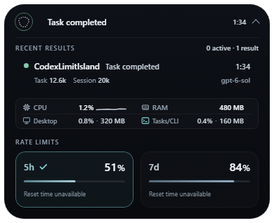
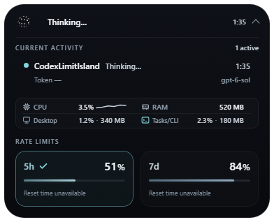
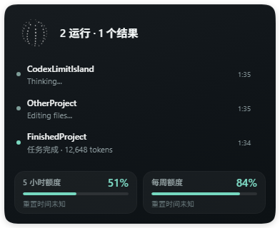
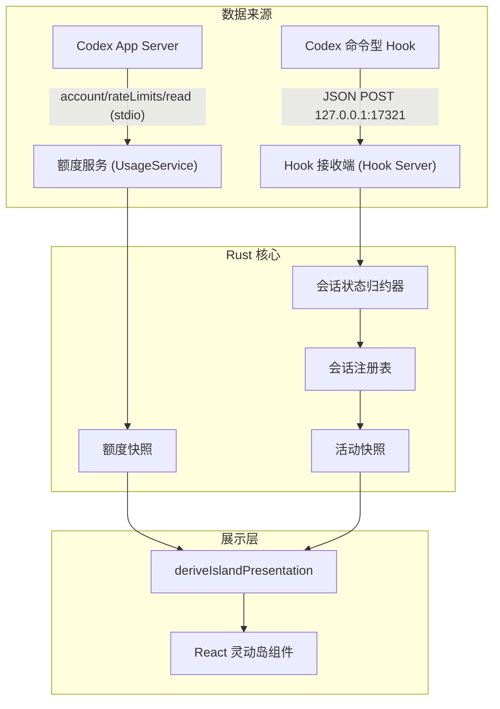

# Codex Limit Island (限额灵动岛)

<p align="center">
  
</p>

<p align="center">
  <strong>专为 OpenAI Codex 打造的轻量级桌面悬浮灵动岛</strong><br>
  实时监控 5 小时与每周额度配额、重置倒计时，无缝联动 Codex 会话活动状态与 Token 统计。
</p>

<p align="center">
  
  
  
  
</p>

---

## 📸 界面预览

|                          悬浮胶囊状态 (Compact)                           |                        任务完成与 Token 统计 (Expanded)                         |
| :-----------------------------------------------------------------------: | :-----------------------------------------------------------------------------: |
|  |  |
|                          **实时思考与动作状态**                           |                            **多会话与子 Agent 协同**                            |
|   |        |

---

## ✨ 核心特性

- 📊 **额度查看**：展开后同时展示 Codex **5 小时窗口**与**每周窗口**的剩余额度；紧凑态显示其中一个窗口，可在托盘菜单中切换。额度数据提供重置时间时，显示重置倒计时。
- 🏝️ **灵动岛交互**：以小巧的胶囊悬浮置顶，点击展开详细卡片，支持沿屏幕顶部水平拖动。
- ⚡ **深度 Hook 联动**：深度接入 Codex 命令型 Hook，实时感知 Codex 会话的生命周期与具体行为（思考中、搜索代码、执行命令、等待审批、上下文压缩等），动态呈现呼吸 Orb 动效。
- 🔢 **Token 消耗透视**：任务完成时自动统计本次任务（Turn）消耗的 Tokens 及当前会话累计 Tokens，使用情况一目了然。
- 🛡️ **本地处理**：
  - 不直接读取 Codex 登录凭证文件，不保存 API Key、登录令牌、提示词或工具输出；
  - Hook 原始 JSON 通过本机环回接口转发，接收端只保留状态所需的元数据；Token 统计来自本地 Codex 会话文件；
  - 会话活动与 Token 缓存保留在内存中，应用设置、退出标记和受控诊断日志保存在本地。
- 🔌 **智能唤醒与退出尊重**：
  - 在 Codex 触发任务时可自动按需拉起灵动岛；
  - 当用户在系统托盘明确选择“退出”后，会记录退出意愿，后续不再随意唤醒打扰。

---

## 🚀 快速上手

### 1. 下载与安装

进入 [Releases](https://github.com/Chilldd/CodexLimitIsland/releases/latest) 页面，下载 Windows x64 安装包。

- [下载 v0.1.0 安装包（Windows x64）](https://github.com/Chilldd/CodexLimitIsland/releases/download/v0.1.0/CodexLimitIsland_0.1.0_x64-setup.exe)
- [查看所有版本](https://github.com/Chilldd/CodexLimitIsland/releases)

下载后双击安装包，按安装向导完成安装。

> **运行条件**：需要可用且已登录的 Codex CLI 或 Codex App 内置程序。灵动岛通过该程序读取额度，不提供独立登录功能。
>
> **平台说明**：当前仅提供 Windows x64 安装包，窗口与点击区域针对 Windows 适配。macOS/Linux 尚未验证，当前打包配置仅启用 Windows NSIS。
>
> **签名说明**：v0.1.0 安装包未进行代码签名，可使用 Release 中的 `SHA256SUMS.txt` 校验文件完整性。

---

### 2. 配置 Codex Hook（推荐）

通过配置 Codex 命令型 Hook，灵动岛可以在后台实时感知 Codex 的运行状态、进度及 Token 消耗。

1. 打开或创建当前用户的 `%USERPROFILE%\.codex\hooks.json`。使用自定义 `CODEX_HOME` 时，将文件放在该目录下。
2. 参考完整的 [hooks.example.json](hooks.example.json)，将各事件配置合并到现有的 `hooks` 对象中。已有其他 Hook 时保留原配置，避免重复添加本程序。
3. 将示例中每个 `command` 替换为本机可用的命令。示例覆盖会话开始/结束、提交任务、工具调用、子代理、审批、压缩和中断共 12 种事件；`SessionEnd` 与 `Interrupt` 使用 3 秒超时，其余使用 12 秒。

若 `codexlimit.exe` 已在 `PATH` 中，命令字段保持为：

```json
{
  "command": "codexlimit.exe --hook"
}
```

若未加入 `PATH`，填写安装后的实际路径，并用双引号包住可执行文件路径。例如安装位置为 `C:\Program Files\Codex Limit Island\codexlimit.exe` 时，字段应写为：

```json
{
  "command": "\"C:\\Program Files\\Codex Limit Island\\codexlimit.exe\" --hook"
}
```

以上仅展示 `command` 字段，完整 handler 仍需保留示例中的 `type` 和 `timeout`。JSON 中路径反斜杠写为 `\\`，命令内部双引号写为 `\"`。示例安装目录仅作说明，请以实际安装位置为准；安装程序不会自动配置 Hook。

4. 保存后重启 Codex App，在 Hook 审查界面检查并信任当前配置。CLI 用户可使用 `/hooks` 查看和信任 Hook。新增或修改命令后需重新审查，未信任的 Hook 不会执行。详见 [Codex 官方 Hook 文档](https://learn.chatgpt.com/docs/hooks)。
5. 发送一条新消息，确认灵动岛进入运行状态，任务完成后显示结果。若只有额度而没有会话活动，先检查 Hook 命令路径、信任状态与本地端口 `17321` 是否被占用。

---

### 3. 日常使用

- **展开/折叠**：鼠标左键点击灵动岛即可在紧凑态与展开态之间平滑切换。
- **拖拽定位**：按住悬浮岛可沿屏幕顶部水平拖动。
- **托盘菜单**：
  - 在 **“展示额度”** 子菜单选择 **“5 小时限额 (5h)”** 或 **“每周限额 (7d)”**，切换紧凑态显示的额度；
  - 找不到 Codex 时可点击托盘右键菜单中的 **“设置 Codex 程序路径…”** 手动指定 `codex.exe`（内置连接自检）；
  - 随时选择 **“恢复默认路径”**；
  - 点击 **“退出”** 彻底关闭悬浮岛。

通过托盘退出后，Hook 不会自动重新启动灵动岛；再次手动启动程序后恢复自动唤醒。

---

## 🏗️ 架构与数据流

灵动岛采用双通道设计，将额度读取与会话动态严格解耦：



- **额度服务**：启动 `codex.exe app-server`，通过标准输入输出调用 `account/rateLimits/read`，按 `windowDurationMins` 识别 5 小时与每周额度。
- **Hook 状态流**：Hook 命令将事件发送给本地轻量 HTTP 端口，在内存中完成轻量状态推导，详见 [状态系统与事件流说明文档](docs/state-machine.md)。

---

## 🛠️ 参与开发

欢迎提交 PR 或 Issue 一起完善项目！

### 环境准备

- **Node.js**：`^24.15.0` 或 `>=26`，与 `package.json` 的版本约束一致。
- **Rust**：Stable（需安装 `rustfmt` 和 `clippy`）；项目声明最低 1.89，本机验证版本为 1.96，最低可构建版本还受锁定依赖约束。
- **Windows**：系统需安装 WebView2 Runtime（Windows 10/11 通常已自带）与 C++ 生成工具

### 常用命令

```powershell
# 1. 安装锁定依赖
npm.cmd ci

# 2. 启动前端 + Tauri 本地开发
npm.cmd run tauri dev

# 3. 运行完整质量检查（包含 ESLint 0 warning、类型检查、Vitest、Rust Clippy/Test）
npm.cmd run check

# 4. 单独代码格式化
npm.cmd run format
cargo fmt --manifest-path src-tauri/Cargo.toml

# 5. 生成/检查 Rust 与 TypeScript 跨层契约
npm.cmd run contracts:generate
npm.cmd run contracts:check

# 6. 构建 Windows NSIS 安装包
npm.cmd run tauri build
```

打包完成后，安装包将输出至：`src-tauri/target/release/bundle/nsis/`。

更多规范请参阅 [贡献指南 (CONTRIBUTING.md)](CONTRIBUTING.md)。

---

## 🔒 隐私与安全性保障

- **额度读取**：调用已登录 Codex 程序的 app-server 接口，不直接读取登录凭证文件，也不记录登录令牌。Codex 程序自身负责账户认证及额度查询。
- **Hook 数据**：发送端将标准输入中的原始 JSON 转发到本机，内容可能包含提示词、工具参数或工具输出。接收端只在内存保留会话、目录、模型、事件类型和工具名等状态元数据，不持久化这些原始内容。
- **Token 统计**：读取 `CODEX_HOME/sessions/`（默认 `%USERPROFILE%\.codex\sessions\`）中的会话 JSONL 文件，提取 Token 用量记录；该文件格式依赖 Codex 版本，缺少对应记录时不显示本次 Token 数量。
- **本地文件**：应用配置、退出标记和诊断日志保存在 `%USERPROFILE%\.codex-limit-island\`。日志只记录受控阶段和错误类别，单文件上限 1MiB，保留 2 份备份。
- **服务边界**：HTTP Hook 服务绑定 `127.0.0.1:17321`，设有 1MiB 请求体上限与读取期限；当前协议没有请求身份认证，本机其他进程也可能连接该端口。

---

## 📄 开源许可证

本项目基于 [MIT 许可证](LICENSE) 开源。欢迎自由使用、修改与分发。
