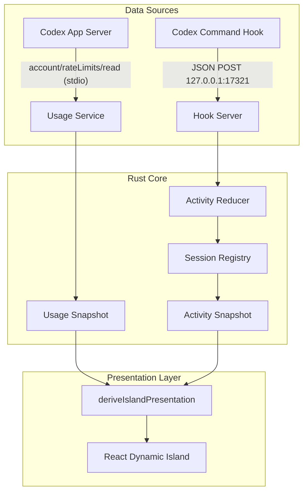

# Codex Limit Island

<p align="center">
  
</p>

<p align="center">
  <strong>A lightweight desktop floating Dynamic Island tailored for OpenAI Codex</strong><br>
  Real-time monitoring of 5-hour and weekly rate limits with reset countdowns, seamlessly integrated with Codex session activities and token metrics.
</p>

<p align="center">
  
  
  
  
</p>

<p align="center">
  <a href="README.md">简体中文</a> | <a href="README_en.md"><b>English</b></a>
</p>

---

## 📸 Preview

|                          Floating Capsule (Compact)                           |                       Task Completed & Token Summary (Expanded)                        |
| :---------------------------------------------------------------------------: | :------------------------------------------------------------------------------------: |
|  |  |
|                       **Real-Time Thinking & Actions**                        |                         **Multi-Session & Sub-Agent Tracking**                         |
|     |    |

---

## ✨ Key Features

- 📊 **Multi-Dimensional Quota Monitoring**: The expanded panel displays progress bars and reset times for both the **5-hour** and **weekly (7-day)** quota windows (with reset countdowns when quota is exhausted). The compact capsule displays your preferred quota window, which can be switched directly by clicking a quota card in the expanded panel or via the system tray menu, with manual one-click refresh support.
- 🏝️ **Smart Adaptive Dynamic Island**:
  - **Compact Capsule**: Dynamic text measurement and adaptive sizing ensure activity status and quota percentage fit naturally without awkward truncation; enhanced with a subtle divider and animated breathing Orb.
  - **Interactive Expanded Panel**: Left-click to smoothly toggle between compact and expanded views. Supports horizontal drag-and-drop along the top edge of your screen with position persistence, screen-bounds clamping, and one-click tray recentering.
- ⚡ **Deep Codex Hook Integration**: Integrates directly with Codex command-style Hooks (with one-click tray configuration) to track session lifecycles and fine-grained behaviors (thinking, searching, editing, command execution, approval requests, context compaction, etc.) with real-time breathing Orb effects.
- 🚀 **One-Click Session Navigation**: Click the main session headline or any item in the multi-task list to immediately bring up and focus the corresponding session in the Codex App.
- 💬 **Idle Status Ticker**: When completely idle with no active sessions or recent turn history, the expanded panel subtitle rotates lighthearted developer status lines every 5 seconds; after a turn finishes, it displays the last turn status and token summary instead.
- 🗂️ **Multi-Task & Model Visibility**: Displays concurrent sessions and background sub-agent tasks, complete with active model tags and dynamic elapsed timers.
- 🔢 **Token Consumption Transparency**: Automatically captures and presents Turn Token usage upon task completion as well as cumulative Session Tokens.
- 🛡️ **100% Local Processing & Privacy**:
  - Never accesses credentials, login tokens, prompt contents, or tool execution outputs;
  - Hook JSON payloads are transmitted via local loopback (`127.0.0.1`), preserving only essential state metadata in memory; Token metrics are read from local session logs;
  - Session activity and token caches exist solely in memory, while app settings, exit markers, and controlled diagnostic logs are stored locally.
- 🔌 **Intelligent Auto-Start & Tray Exit Respect**:
  - Can automatically launch the island on demand when Codex initiates tasks;
  - If you explicitly choose "Exit" from the system tray, your choice is respected and auto-wakeups are suppressed until you manually start the application again.

---

## 🚀 Quick Start

### 1. Download & Installation

Visit the [Releases](https://github.com/Chilldd/CodexLimitIsland/releases/latest) page to download the latest Windows x64 installer.

- [Download v0.1.1 Installer (Windows x64)](https://github.com/Chilldd/CodexLimitIsland/releases/download/v0.1.1/CodexLimitIsland_0.1.1_x64-setup.exe)
- [View All Releases](https://github.com/Chilldd/CodexLimitIsland/releases)

Run the installer and follow the setup wizard.

> **Prerequisite**: An active and logged-in Codex CLI or Codex App installation. The island queries rate limits through the Codex executable and does not provide standalone login functionality.
>
> **Platform Support**: Currently optimized and packaged for Windows x64 (NSIS). macOS/Linux packaging is not yet configured.
>
> **Code Signature**: The v0.1.1 installer is not digitally signed. You can verify binary integrity using `SHA256SUMS.txt` provided in the release.

---

### 2. Configure Codex Hooks (Recommended)

Configuring Codex command-style Hooks enables real-time activity status, lifecycle tracking, and Token metrics in the island.

- **One-Click Configuration (Recommended)**: Right-click the system tray icon and select **"Configure Codex Hook…"** (`配置 Codex Hook…`). The app will safely merge the current executable's hook rules into `%USERPROFILE%\.codex\hooks.json` while preserving any existing third-party hooks. Afterward, fully exit and restart the Codex App and approve the hook in the review prompt.
- **Manual Configuration**:

1. Open or create `%USERPROFILE%\.codex\hooks.json` (or under your custom `CODEX_HOME` directory).
2. Refer to [hooks.example.json](hooks.example.json) and merge the hook definitions into your existing `hooks` object.
3. Replace the `command` field in each handler with the correct executable path. The example covers 12 event types, including session lifecycle, tool execution, sub-agents, approvals, and compression.

If `codexlimit.exe` is added to your `PATH`:

```json
{
  "command": "codexlimit.exe --hook"
}
```

If not in `PATH`, use the absolute path enclosed in quotes. For example, if installed in `C:\Program Files\Codex Limit Island\codexlimit.exe`:

```json
{
  "command": "\"C:\\Program Files\\Codex Limit Island\\codexlimit.exe\" --hook"
}
```

4. Save the file and restart Codex App. Review and trust the configuration in the Hook Review interface (or execute `/hooks` in Codex CLI). Modified hooks require re-approval before execution. See [Codex Official Hook Documentation](https://learn.chatgpt.com/docs/hooks).
5. Send a prompt in Codex to verify that the island transitions to active state and displays turn results upon completion.

---

### 3. Daily Usage

- **Expand / Collapse**: Click the island to smoothly switch between compact capsule and expanded card views.
- **Switch Compact Limit Window**: Click either the **5-hour** or **weekly** quota card directly in the expanded panel (or switch via the tray menu) to set it as the default window shown in compact mode.
- **Drag Positioning**: Click and drag horizontally along the top edge of the display; the position is automatically persisted with screen-bounds protection across resolution or monitor changes.
- **Direct Session Jump**: Click the session title or any item in the session list within the expanded card to immediately activate and focus the conversation in the Codex App.
- **Idle Status Ticker**: Rotates lighthearted developer status lines every 5 seconds when idle with no recent turn history, or shows the last turn summary after a task finishes.
- **Tray Menu**:
  - Click **"Refresh Rate Limits"** (`立即刷新额度`) to trigger an immediate quota sync;
  - Switch displayed limit in compact mode via **"Display Limit"** (`展示额度`: `5h` or `7d`);
  - Click **"Reset Window Position"** (`重置窗口位置`) to recenter the island at the top of the primary monitor;
  - Click **"Configure Codex Hook…"** (`配置 Codex Hook…`) to write or repair `%USERPROFILE%\.codex\hooks.json` in one click;
  - Manually configure `codex.exe` path via **"Set Codex Path…"** (`设置 Codex 程序路径…`, includes built-in connectivity diagnostics), or select **"Restore Default Path"** (`恢复默认路径`) at any time;
  - Choose **"Exit"** (`退出`) to completely shut down the application.

Exiting via the system tray stops the island from automatically waking up on subsequent Hook events until the program is manually restarted.

---

## 🏗️ Architecture & Data Flow

Codex Limit Island utilizes a dual-channel architecture that strictly decouples rate limit querying from session event tracking:



- **Usage Service**: Spawns `codex.exe app-server` and queries `account/rateLimits/read` via standard I/O, determining 5-hour and weekly quotas via `windowDurationMins`.
- **Hook State Flow**: The hook command forwards event JSON to the local lightweight HTTP server, updating memory state reducers. See [State Machine & Event Flow Documentation](docs/state-machine.md) for details.

---

## 🛠️ Development & Contributing

Contributions and feedback are warmly welcomed!

### Prerequisites

- **Node.js**: `^24.15.0` or `>=26` (as specified in `package.json`).
- **Rust**: Stable (with `rustfmt` and `clippy` installed). Minimum declared version is 1.89, verified on 1.96.
- **Windows**: WebView2 Runtime (preinstalled on Windows 10/11) and C++ Build Tools.

### Common Commands

```powershell
# 1. Install dependencies
npm.cmd ci

# 2. Start frontend + Tauri in development mode
npm.cmd run tauri dev

# 3. Run comprehensive quality checks (ESLint 0 warning, typecheck, Vitest, Clippy, Rust tests)
npm.cmd run check

# 4. Code formatting
npm.cmd run format
cargo fmt --manifest-path src-tauri/Cargo.toml

# 5. Generate / verify Rust <-> TypeScript contracts
npm.cmd run contracts:generate
npm.cmd run contracts:check

# 6. Build Windows NSIS installer
npm.cmd run tauri build
```

The compiled installer will be generated at: `src-tauri/target/release/bundle/nsis/`.

For more details, please review our [Contributing Guide (CONTRIBUTING.md)](CONTRIBUTING.md).

---

## 🔒 Privacy & Security Guarantees

- **Rate Limit Extraction**: Communicates with the local Codex app-server via standard I/O; never reads stored authentication tokens or sensitive credentials directly.
- **Hook Data Handling**: Standard input payloads are forwarded to loopback `127.0.0.1`. The server retains only session IDs, tool names, event types, and model metadata in memory, dropping raw prompts, parameters, and outputs.
- **Token Metrics**: Extracted from local turn records in `CODEX_HOME/sessions/` (`%USERPROFILE%\.codex\sessions\`); does not modify or upload session data.
- **Local Storage**: User preferences, exit flags, and diagnostic logs are stored under `%USERPROFILE%\.codex-limit-island\`. Logs are limited to 1 MiB with a 2-file retention cap.
- **Loopback Boundaries**: Hook HTTP server listens strictly on `127.0.0.1:17321` with a 1 MiB body ceiling and strict read timeouts.

---

## 📄 License

This project is licensed under the [MIT License](LICENSE).
