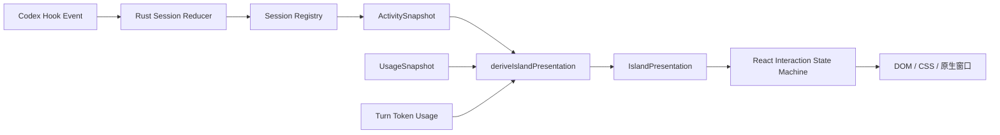
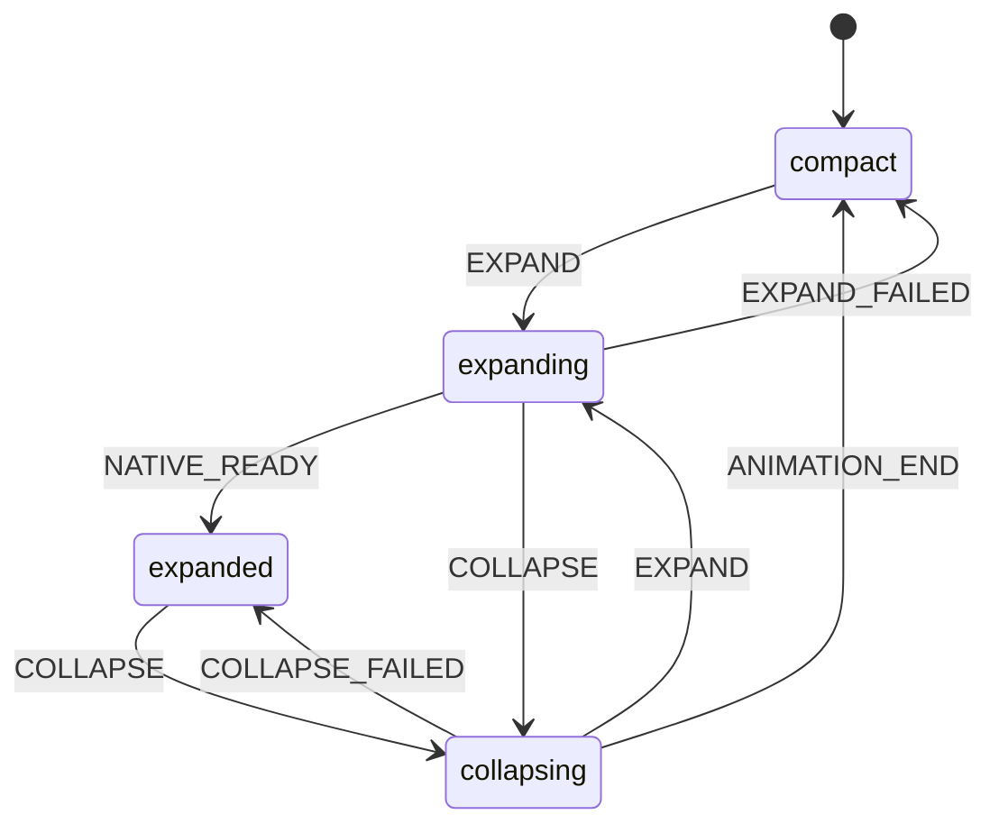

# 状态系统与事件流

本文记录当前实现，修改状态规则时应同步更新本文和相关测试。主要代码位于 `src-tauri/src/activity/`、`src/islandState.ts`、`src/islandInteraction.ts`、`src/windowController.ts`、`src/hooks/` 和 `src/components/`；`src/App.tsx` 负责组合。

## 状态归属

| 维度         | 所属层               | 当前取值或内容                                                                         | 含义                                                         |
| ------------ | -------------------- | -------------------------------------------------------------------------------------- | ------------------------------------------------------------ |
| Lifecycle    | Rust Session         | `idle`、`active`                                                                       | 当前 Turn 是否在活动阶段；`SessionEnd` 结束 Session 生命周期 |
| Activity     | Rust Session / Agent | `thinking`、`working`、`searching`、`editing`、`executing`、`connecting`、`compacting` | Codex 正在做什么；非活动时为 `null`                          |
| Attention    | Rust Session / Agent | `none`、`permission`                                                                   | 用户是否需要处理审批，不覆盖 Activity                        |
| Turn Result  | Rust Registry        | `completed`、`interrupted`，附 Session ID、Turn ID、完成时间、项目、模型和起始时间     | 单个 Root Turn 的不可变快照；不属于 Session Activity         |
| Token Usage  | React 查询状态       | `loading`、`ready`、`unavailable`                                                      | 附属于 Completed Turn Result                                 |
| Presentation | TypeScript 纯函数    | `layout`、`attention`、`feedback`、文案、Orb 等                                        | 决定界面显示什么                                             |
| Interaction  | React reducer        | `compact`、`expanding`、`expanded`、`collapsing`                                       | 控制展开动画与原生窗口操作                                   |

`ActivitySnapshot` 包含当前活动的 `sessions`、独立的 `recentResults` 和 `updatedAt`。`useActivity()` 通过 `activity-updated` 订阅更新，首次加载使用 `read_activity`；`newerActivity()` 拒绝较旧的快照。`useUsage()` 保留事件与首次读取之间的版本守卫。两者都会清理卸载后才完成注册的监听。额度由另一条链路提供，不写入 Session Activity。

## Rust 事件归约

HTTP Hook 只读取状态所需的元数据，`apply_event()` 检查 Turn 身份后调用 `reduce_session()`。会话字段、Agent、ActiveTool 和 Result 的业务转换集中在 reducer；Registry 管理索引、结果列表与清理时间。

HTTP 204 仍在 Registry 更新和界面通知成功后返回；通知失败或响应丢失不回滚已更新的状态。sender 仅在尚未建连时尝试启动 GUI 并重试，建连后的确认丢失返回明确错误，不自动重发。同一已知 Turn 的 Root `UserPromptSubmit` 重发不会清空工具、重置开始时间或复活完成结果；同一仍在运行的 `tool_use_id` 重发不会更改工具前台顺序。缺少事件身份的旧 Hook 保留原兼容语义，不使用短时间去重推测事件是否重复。

| Hook 事件                        | Root Turn / Session 的转换                                         | Agent 事件的转换                                                 |
| -------------------------------- | ------------------------------------------------------------------ | ---------------------------------------------------------------- |
| `SessionStart`                   | 建立或更新会话元数据，不启动 Turn                                  | —                                                                |
| `UserPromptSubmit`               | 清除旧 Tool，设置新 Turn ID、`active + thinking + none`            | 活动 Root 下设 Agent 为 `thinking + none`                        |
| `PreToolUse`                     | 登记 ActiveTool，清除 Root Attention，按前台 Tool 推导 Activity    | 登记 Agent Tool，Agent 设为 `working + none`                     |
| `PostToolUse`                    | 只移除匹配 Tool，清除 Root Attention，重新计算前台 Activity        | 移除匹配 Agent Tool，Agent 回到 `thinking + none`                |
| `PermissionRequest`              | Attention 设为 `permission`，保留当前 Activity                     | Agent Attention 设为 `permission`                                |
| `PreCompact` / `PostCompact`     | Root 基础 Activity 在 `compacting` / `thinking` 间切换             | Agent Activity 在 `compacting` / `thinking` 间切换               |
| `SubagentStart` / `SubagentStop` | Root Activity 不被 Agent 生命周期直接覆盖                          | Agent 开始为 `thinking`；结束后 Activity 为 `null` 并清理其 Tool |
| `Stop`                           | 活动 Root 生成 `completed` Turn Result，结束当前 Turn、清理 Tool   | 只结束该 Agent，不生成 Root Result                               |
| `Interrupt`                      | 活动 Root 生成 `interrupted` Turn Result，结束当前 Turn、清理 Tool | 只结束该 Agent，不生成 Root Result                               |
| `SessionEnd`                     | 结束 Session 生命周期、清理 Tool 和 Agent；不再生成 Result         | —                                                                |

当事件带 Turn ID 且与当前 Turn 不一致时，旧事件被忽略；没有 Turn ID 的旧 Hook 保持兼容。空 Registry 首次收到 Agent `PreToolUse`、`SubagentStart` 或 `PermissionRequest` 时允许激活 Session，以便 GUI 晚启动后恢复状态；已结束 Session 的同 Turn 迟到事件会被拒绝，即使 Recent Result 的保留时间已过，也不会复活旧 Turn。Session 是否过期只由 Rust 清理：普通状态 10 分钟，Permission 或仍有 ActiveTool 时 2 小时；Recent Result 保留 12 秒。快照仅发送活动 Session，但可以发送仍在保留期内的 Result。Result 在生成时复制 `project`、`model`、`startedAt`，不再依赖 Session 后续是否存在。

ActiveTool、前台 Activity、当前命令是不同概念。`tool_activity()` 是唯一的 Tool 分类入口。前台选择优先取最近启动的 Root Tool，否则取最近启动的 Agent Tool，最后回到 Root 基础 Activity。因此 Bash 仍运行时，随后启动的 Root Read 会暂时显示 `searching`；Read 结束后恢复 Bash 的 `executing`。`currentCommand` 只来自前台的 Root 执行类 Tool。

## Presentation 与 Result 展示

`deriveIslandPresentation()` 是纯函数，输入 ActivitySnapshot、额度、Token 状态、当前时间和展开期间保留的 Result 集合。它显式排序活动 Session（有效 Permission 优先，其次最近活动时间）和最近 Result（完成时间倒序），同时输出 `sessions` 与 `visibleResults`。Compact 主信息仍按 Permission、额度用尽、活动 Session、Result、Idle 的顺序选择；有活动 Session 和 Result 并存时，Compact 显示运行与完成数量，Expanded 同时列出活动行和结果行。`layout` 只取 `minimal`、`single`、`multi`；Attention 和 Feedback 独立存在。例如多 Session 等待审批仍是 `layout=multi, attention=permission`。`effectiveAttention()` 同时检查 Root 与 Agent，并统一用于排序、主 Session、行文案和黄色 Dot。Orb 表示动作，Ring / Feedback 表示审批、额度或完成反馈；Activity 到文案及 Orb 的映射也集中在此文件。

界面固定文案使用英文，保留项目名和模型的原始值。紧凑态的 Result 默认展示 3 秒。Completed 的 Token 在准备好后还能展示约 2.8 秒；`loading` 与 `unavailable` 的主文案均为“已完成”，`ready` 且有本次 Token 时显示“完成 · 数量”。展开项目行显示所属 Session 的模型、任务 Token 和会话累计 Token；独立 Result 使用完成时快照中的项目、模型与起始时间。运行与完成数量汇总不重复计算同一正在运行 Session 的上次结果，但仍保留完整 `visibleResults`。`useHeldResults()` 在 expanding、expanded 和 collapsing 期间保留最近 Result，到 compact 才释放；即使 Rust 的 12 秒保留期结束，展开内容与已查询到的 Token 仍可显示。Permission 和额度不会从 `visibleResults` 中删除 Result。

`deriveIslandPresentation()` 同时输出类型化的 rows、headline、meta、usageRows、额度 tone 与 ARIA 文案；导航忙碌和错误由交互层管理。项目回退、子代理数量和状态文案不在 JSX 中重复推导。展开态始终使用统一项目区域，rows 按 Session ID 合并运行状态与该会话最近结果，同名但不同 Session 的项目保持独立。模型、任务 Token 和会话 Token 均属于各自项目行；最多显示三行，更多项目通过纵向滚动访问。

`useIslandPresentation()` 只为下一个 Result 到期时间设置一次性 `setTimeout`，结合事件观察时间和相关 Token readyAt 进行纯函数推导；没有保留结果时复用 Live 展示。Elapsed 的秒级刷新仅更新时间文本组件，不再触发整棵 App 或 Presentation。完全 Idle 且无待过期 Result 时不设周期定时器。Token 状态、Hook 快照和额度更新会触发即时推导，不需要常驻轮询。

Token 查询由 Completed Turn Result 驱动，键优先使用 `sessionId:turnId`；旧 Hook 缺 Turn ID 时才使用完成时间构成回退键。`useTurnTokenUsage()` 在 300、800、800 毫秒后依次尝试查询，得到本次 Token 设为 `ready`，连续无数据或调用失败设为 `unavailable`。Interrupted Result 不查询 Token。Presentation 按 Session 保留相关最近结果及已读取用量：只保留活动会话、当前快照 / held Result 和全局最近结果引用的摘要，其余释放。运行行以“上次任务”标识已完成 Turn 的用量，累计值也是该次读取的快照；Session Activity 不触发 Token 查询。

## React 展开与窗口交互

`useInteractionMachine()` 用 `useReducer` 与同步 ref 维护交互阶段，拖动由 `useHorizontalDrag()` 管理。`useIslandWindow()` 将原生接口注入 `windowController.ts`，尺寸与点击区域操作通过队列串行执行，避免快速展开/收起时旧异步操作覆盖新状态。展开时先放大原生窗口并设置点击区域，再进入 `expanded`；收起时先播放 340 毫秒 Morph，再缩小原生窗口。鼠标离开岛区域后等待 420 毫秒才自动收起；在等待期间重新进入会取消计时。展开过程中鼠标离开也遵守同一个延迟。用户点击收起仍立即开始收起过程。

`nativeOperations.ts` 提供可注入原生接口与计时器的执行函数。交互转换时递增队列版本；等待尺寸或点击区域完成后再次校验版本，组件卸载后停止后续操作，避免旧操作在状态绕回同名阶段时继续执行。收起优先响应高度过渡结束事件，兜底恢复原生窗口的延迟保持为 420 毫秒，减少动态效果时为 190 毫秒。开发构建仅额外允许 `384×550` 的 Debug 点击区域，Release 仍限制在 `100..=390 × 40..=444`。

DOM 同时保留 `layout-*` 与 `expanded` 类，并以 `data-attention`、`data-feedback` 表示其它维度。CSS 不自行推断业务状态。`styles/tokens.css` 与 `domain/metrics.ts` 中的尺寸由跨文件测试约束：2px 根内边距将 96px 及紧凑态 136/156/172px 可见宽度对应到 100px 及 140/160/176px 点击区；380px 展开宽度对应 384px 点击区，最大允许高度 440px 对应 444px 原生上限。统一布局按 1 / 2 / 3 个项目行分别使用 316 / 376 / 436px，高于三行时停止增高。展开与收缩的 Orb 画布均按 20px 逻辑尺寸直接绘制，不再使用 CSS 缩小画布；原有透明度过渡与暂停规则保持不变。监控栏固定两行显示总览与明细，不保留悬停或点击切换状态。`useReducedMotion()` 订阅系统设置变化，并在卸载时清理。

`App.css` 统一导入样式。公共 tokens、基础样式、语义色和组件样式分别管理；`styles/glass.css` 沿用容器类名，提供不透射背景的冷黑表面与低对比内卡片，不使用背景模糊或折射。视觉规范见 `design.md`。

开发模式下通过 `?debugIsland` 打开 Presentation Playground；它构造 ActivitySnapshot、UsageSnapshot 和 TokenUsageState，仍经同一个 `deriveIslandPresentation()` 渲染，不影响真实额度和 Hook 数据。Rust 状态机测试位于 `activity/tests.rs`；Presentation 与 Interaction 测试位于 `tests/islandState.test.ts`、`tests/presentation.test.ts`。真实窗口尺寸、Hit Region、Hook 信任与自动启动仍需在 Windows 运行环境中回归。

可控 Promise、假时钟、原生错误及卸载回归位于 `tests/nativeOperations.test.ts`、`tests/windowController.test.ts`；实际 React hooks、拖动、导航和 App 集成测试位于 `tests/hooks.test.tsx`。这些自动化测试不替代真实窗口与 Hook 链路验收。

## 数据与资源边界

Hook 原始 JSON 由 sender 原样转发；已知事件类型只参与 deadline/日志判断，未来事件不会被 sender 静默过滤。server 在有界解析后转换为 `HookEventKind`，未知事件返回 400。`activity/registry.rs` 管理索引与清理，`reducer.rs` 负责 Session、Agent、Tool、Result 的转换。Registry 与 UsageService 均由 Managed State 持有，Hook 显式请求 UsageRefresher，刷新仍遵循 30 秒等待超时与事件合并规则。

HTTP 正常处理顺序仍为更新 Registry、发送 activity-updated、按需请求额度刷新、返回 204。连接数由 8 个 worker 与 16 个排队位置限制，满载时返回 503。16KiB Header 与 1MiB Body 在同一 1 秒读取期限内完成；重复 Content-Length 和 Transfer-Encoding 明确拒绝。非法请求返回 400 后有限排空已到达数据，避免 Windows 未读请求体导致确认响应丢失。

Rust TokenUsageReader 的索引以 Codex Home 和 Session ID 为键，最多 64 项；每文件保留 128 个已请求 Turn。相同 Session 查询共享锁与文件偏移，追加内容增量解析；新查询旧 Turn 时按需回扫。文件路径不存在、身份变化、截断或等长改写后失效重建。单行超过 1MiB 时有界跳过；缺少请求 Turn 数据继续返回 null，不用会话总量代替。

`useTurnTokenUsage(results, heldResults)` 保留当前快照、展开保留结果及正在查询的键，完成后移除无引用项；卸载取消等待计时器并使晚到 Promise 失效。StrictMode 的上一轮查询不能覆盖当前任务。位置写入器让拖动至多一个请求在途，后续 RAF 仅替换最新目标；卸载不再提交尾随移动。

`src/generated/contracts.ts` 来自 Rust 的 Serialize 与 ts-rs 派生，契约检查涵盖 camelCase、枚举字面量、null 和 JSON number；前端交互/展示类型继续由 TypeScript 定义。生成与漂移检查位于 `src-tauri/src/contracts.rs`；日志轮转和多进程写入测试位于 `diagnostics.rs`，HTTP 并发与资源边界测试位于 `hook/server.rs`，Token 增量读取与缓存边界测试位于 `token_usage.rs`。
